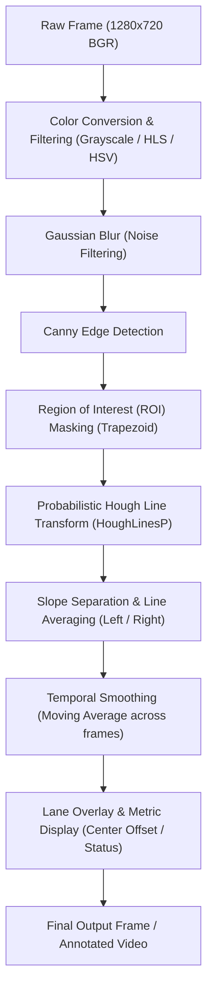

# Project Plan: Dashcam Car Lane Line Detection with OpenCV

## 1. Project Overview
The objective of this project is to develop an automated lane line detection system using computer vision techniques in Python with OpenCV. The system processes dashcam footage to identify, highlight, and track the ego-vehicle's driving lane in real-time or as an annotated exported video.

---

## 2. Environment & Assets

### System & Dependencies
- **Python Version**: `3.14.7` (configured in `.venv`)
- **Core Libraries**:
  - `opencv-python` (5.0.0.93) - Image and video manipulation, edge detection, Hough transforms
  - `numpy` (2.5.4) - Vectorized array operations, linear regressions, polynomial fitting
  - `matplotlib` (3.11.2) - In-notebook plotting and color space debugging
  - `jupyterlab` / `notebook` / `ipykernel` - Interactive exploration and documentation
- **Jupyter Kernel**: Registered as `"Python (.venv - opencvCARline)"` (`opencvCARline`)

### Input Media Details
- **Video File**: `2026-10-14 14-08-25.mp4`
- **Resolution**: 1280 x 720 (720p HD)
- **Frame Rate**: 30.0 FPS
- **Total Frames**: 1547 frames (~51.57 seconds)
- **Initial Inspection**: Mean frame brightness ~155 (daylight conditions)

---

## 3. Computer Vision Pipeline

### Detailed Pipeline Steps:
1. **Pre-processing & Color Filtering**:
   - Convert frame to grayscale or isolate yellow & white lane markings using HLS/HSV color thresholds to maintain robust detection under varying road asphalt colors.
2. **Noise Reduction**:
   - Apply Gaussian Blur ($5 \times 5$ kernel) to suppress high-frequency road textures and asphalt imperfections.
3. **Edge Detection**:
   - Run Canny Edge Detection with calibrated low/high gradient thresholds (e.g. 50/150).
4. **Region of Interest (ROI)**:
   - Apply a dynamic polygon mask (trapezoidal) that focuses on the road surface directly ahead of the vehicle, eliminating the sky, hood, and surrounding roadside clutter.
5. **Line Segment Detection**:
   - Use `cv2.HoughLinesP` to extract line segment coordinates $(\rho, \theta)$.
6. **Classification & Fitting**:
   - Classify detected segments into **Left Lane** (negative slope) and **Right Lane** (positive slope), filtering out nearly horizontal lines (slope thresholding).
   - Fit a single smoothed line or curve to both sides using linear regression (`np.polyfit`).
7. **Temporal Smoothing (Stability)**:
   - Use exponential moving averages (EMA) across consecutive frames to prevent jitter when lane lines are broken, dashed, or momentarily occluded.
8. **Visualization & HUD**:
   - Overlay a semi-transparent colored polygon on the driving corridor between the detected lanes.
   - Calculate vehicle lane offset (distance from lane center) and overlay driving telemetry.

---

## 4. Implementation Milestones

| Stage | Milestone | Deliverable |
| :--- | :--- | :--- |
| **Phase 1** | **Setup & Environment Verification** | `.venv` validated, packages verified, Jupyter kernel configured. *(Completed)* |
| **Phase 2** | **Perspective & Thresholding Calibration** | Source trapezoid calibrated for 1280x720 dashcam, HLS+LAB+Sobel-X thresholding pipeline tested. *(Completed)* |
| **Phase 3** | **Sliding Windows & 2nd-Degree Polyfit** | Window search, parabolic polynomial fitting ($x = Ay^2 + By + C$), curvature, and vehicle offset computation. *(Completed)* |
| **Phase 4** | **Modular Pipeline & Temporal Smoothing** | [`lane_detector.py`](file:///c:/Users/Mourad/Desktop/MOURADCV/opencvCARline/lane_detector.py) implemented with `LaneTracker` and Exponential Moving Average (EMA) smoothing. *(Completed)* |
| **Phase 5** | **Jupyter Notebook & Video Verification** | [`lane_detection.ipynb`](file:///c:/Users/Mourad/Desktop/MOURADCV/opencvCARline/lane_detection.ipynb) created and executed; [`output_tracked_preview.mp4`](file:///c:/Users/Mourad/Desktop/MOURADCV/opencvCARline/output_tracked_preview.mp4) rendered. *(Completed)* |
| **Phase 6** | **OpenCV Failure Analysis & Documentation** | Detailed documentation of classical CV failure modes on mountain/coastal roads in Section 9 of the notebook. *(Completed)* |
| **Phase 7** | **Deep Learning: YOLOP Panoptic Perception** | Integrated pre-trained [`yolop-640-640.onnx`](file:///c:/Users/Mourad/Desktop/MOURADCV/opencvCARline/yolop-640-640.onnx), [`yolop_detector.py`](file:///c:/Users/Mourad/Desktop/MOURADCV/opencvCARline/yolop_detector.py), and [`live_yolop_tracker.py`](file:///c:/Users/Mourad/Desktop/MOURADCV/opencvCARline/live_yolop_tracker.py). *(Completed)* |
| **Phase 8** | **Upgrade to YOLOPv2 (SOTA)** | Downloaded [`yolopv2.onnx`](file:///c:/Users/Mourad/Desktop/MOURADCV/opencvCARline/yolopv2.onnx) (148.7 MB), upgraded [`yolop_detector.py`](file:///c:/Users/Mourad/Desktop/MOURADCV/opencvCARline/yolop_detector.py) with dynamic model switching, and updated [`live_yolop_tracker.py`](file:///c:/Users/Mourad/Desktop/MOURADCV/opencvCARline/live_yolop_tracker.py). *(Completed)* |
| **Phase 9** | **2D Aerial Map Ego Vehicle Calibration** | Shifted blue ego vehicle from `x=180` to `x=198` (+18px right) to achieve 36px symmetric clearance; added live `[` / `]` hotkeys and re-exported preview video. *(Completed)* |
| **Phase 10** | **Optimal Trajectory Path Planning (in Blue)** | Computed polynomial path in BEV space with temporal EMA smoothing; rendered glowing blue spline & AR ribbon on front camera + BEV map; added `[T]` live toggle. *(Completed)* |
| **Phase 11** | **Generalization to Unmarked Roads (`2026-10-14 14-07-10.mp4`)** | Replaced artificial fixed-width window with contiguous corridor segmentation; accurately navigates wide unmarked roads and curves around parked vehicles. *(Completed)* |

---

## 5. Completed Architectures

### Architecture 1: Classical OpenCV (Option B)
- **Module**: [`lane_detector.py`](file:///c:/Users/Mourad/Desktop/MOURADCV/opencvCARline/lane_detector.py) containing class [`LaneTracker`](file:///c:/Users/Mourad/Desktop/MOURADCV/opencvCARline/lane_detector.py#L16-L235).
- **Interactive Player**: [`live_lane_tracker.py`](file:///c:/Users/Mourad/Desktop/MOURADCV/opencvCARline/live_lane_tracker.py).

### Architecture 2: Deep Learning Panoptic Perception (YOLOP & YOLOPv2)
- **Models**:
  - [`yolopv2.onnx`](file:///c:/Users/Mourad/Desktop/MOURADCV/opencvCARline/yolopv2.onnx) *(Default: YOLOv7 E-ELAN architecture, +6.7% mAP, +5.3% F1)*
  - [`yolop-640-640.onnx`](file:///c:/Users/Mourad/Desktop/MOURADCV/opencvCARline/yolop-640-640.onnx) *(YOLOP v1 baseline)*
- **Module**: [`yolop_detector.py`](file:///c:/Users/Mourad/Desktop/MOURADCV/opencvCARline/yolop_detector.py) containing class [`YOLOPDetector`](file:///c:/Users/Mourad/Desktop/MOURADCV/opencvCARline/yolop_detector.py#L86-L300) with automatic GPU acceleration via DirectML.
- **Interactive Player**: [`live_yolop_tracker.py`](file:///c:/Users/Mourad/Desktop/MOURADCV/opencvCARline/live_yolop_tracker.py) with 2D Aerial BEV Radar Map and dynamic display modes.
- **Jupyter Notebook**: [`lane_detection.ipynb`](file:///c:/Users/Mourad/Desktop/MOURADCV/opencvCARline/lane_detection.ipynb) containing Sections 1 through 15 (Classical CV, Failure Analysis, YOLOP v1, 2D Aerial BEV Radar, and SOTA YOLOPv2).

